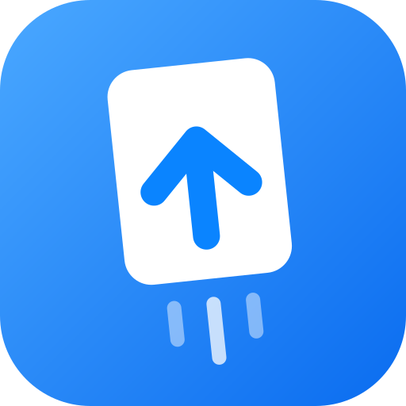
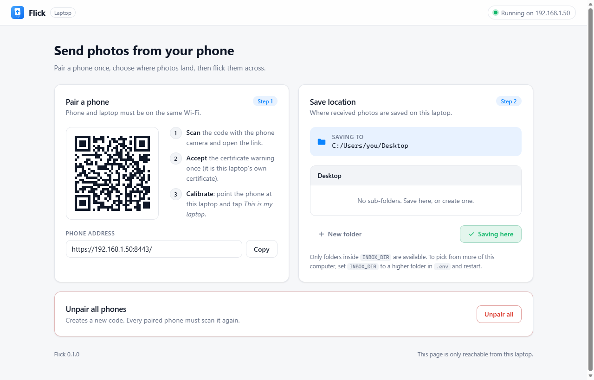
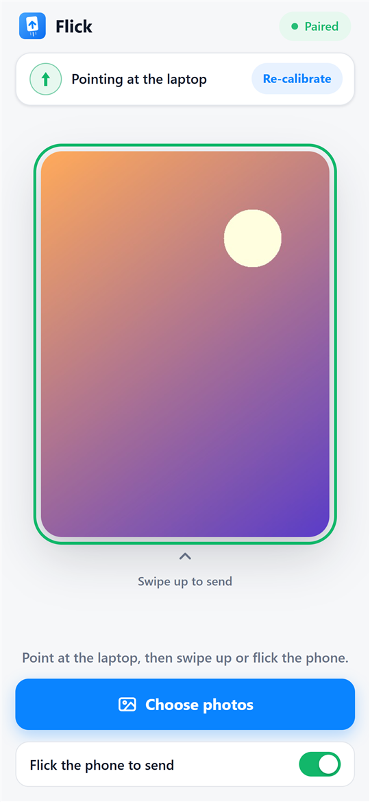
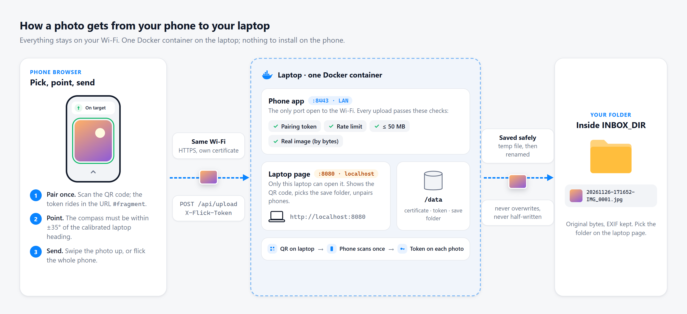

<p align="center"></p>
<h1 align="center">Flick</h1>
<p align="center">Flick photos and videos from your phone straight onto your laptop.<br>Same Wi-Fi, no cloud, no app to install.</p>

<p align="center">
  <picture>
    <source media="(prefers-color-scheme: dark)" srcset="docs/assets/laptop-dark.png">
    
  </picture>
  &nbsp;
  <picture>
    <source media="(prefers-color-scheme: dark)" srcset="docs/assets/phone-dark.png">
    
  </picture>
</p>

Flick is a personal tool for getting photos off your phone without cables, chat apps or
cloud drives. Pick photos or videos on the phone, point the phone at the laptop, and swipe the photo
up, or flick the whole phone towards the laptop. A second later it is in a folder on the
laptop, byte for byte the original.

The laptop runs one small Docker container. The phone opens a web page served by that
container, so there is nothing to install on the phone, and the photo travels straight
across your Wi-Fi. Nothing leaves your network.

## At a glance

| | |
|---|---|
| Phone | Any modern browser: iPhone Safari, Android Chrome. Optional *Add to Home Screen* |
| Laptop | One Docker container: macOS, Windows or Linux |
| Connection | Direct HTTPS on your Wi-Fi, port 8443, with a self-signed certificate made on first start |
| Pairing | Scan a QR code once; the phone stays paired across restarts |
| Sending | Swipe up, or flick the phone, while it points within ±35° of the laptop; one flick can send a whole selection |
| Saved to | A folder you pick on the laptop page, as `YYYYMMDD-HHMMSS-<name>.<ext>` |
| Formats | Photos: JPEG, PNG, HEIC/HEIF, WebP, GIF, up to 50 MB. Videos: MP4, MOV, up to 2 GB. Checked by their bytes |
| Files | Original bytes: no resizing, no re-encoding, EXIF kept |
| License | MIT |

## Setup

You need Docker (Docker Desktop on macOS and Windows) and the laptop and phone on the same
Wi-Fi. About five minutes.

```bash
git clone https://github.com/rimmelasghar/Flicker.git flick
cd flick
scripts/detect-ip.sh          # Windows: powershell -ExecutionPolicy Bypass -File scripts\detect-ip.ps1
# open .env and set INBOX_DIR, e.g. /Users/you/Desktop or C:/Users/you/Desktop
docker compose up -d
```

Then open **http://localhost:8080** on the laptop and scan the QR code with the phone.
Accept the certificate warning once (it is the laptop's own certificate), and you are paired.

`detect-ip` writes the laptop's Wi-Fi address into `.env` as `HOST_IP`, creating `.env` from
`.env.example` if needed. `INBOX_DIR` is the folder Flick may save into; you can pick any
folder inside it later.

<details>
<summary><b>Windows</b>: let the phone reach the laptop</summary>

Windows blocks incoming connections to Docker on networks marked *Public*.

1. Settings → Network & internet → Wi-Fi → your network → Network profile type: **Private**.
2. In PowerShell **run as administrator**, allow the phone port on private networks only:

   ```powershell
   New-NetFirewallRule -DisplayName "Flick phone (8443)" -Direction Inbound -Protocol TCP -LocalPort 8443 -Action Allow -Profile Private
   ```

If OneDrive manages your Desktop, use `C:/Users/<you>/OneDrive/Desktop` as `INBOX_DIR`.

</details>

<details>
<summary><b>macOS</b></summary>

If the application firewall is on and asks whether Docker may accept incoming connections,
choose **Allow**. Docker Desktop shares `/Users` by default, so the Desktop works without
changes.

</details>

<details>
<summary><b>Linux</b></summary>

Set `PUID` and `PGID` in `.env` to the output of `id -u` and `id -g`: the container runs as
that user, so saved photos belong to you. If a firewall is active, open the phone port, for
example `sudo ufw allow 8443/tcp`.

</details>

## Using it

1. **Enable the compass.** iPhone: tap *Enable compass* and allow Motion & Orientation.
   Android starts it by itself.
2. **Calibrate.** Tap *Calibrate*, point the top of the phone at the laptop and tap
   *This is my laptop*. Do it again if the laptop or your seat moves.
3. **Choose photos & videos.** Pick one or many. With several picked, one flick sends them all,
   with a progress bar; switch off *Send all with one flick* to send one per flick.
4. **Send.** While the phone points at the laptop, the needle and the photo outline turn
   green. Swipe the photo up, or hold still for a moment and flick the phone towards the
   laptop. The phone shows *Sent* and the file is in the folder.

**Choose where photos go** on the laptop page: the *Save location* card lets you browse the
folders inside `INBOX_DIR`, create one, and click *Save photos here*. The choice applies at
once and survives restarts.

**Unpair every phone** with *Unpair all* on the laptop page. It makes a new QR code; phones
you keep scan it again.

## How it works

<picture>
  <source media="(prefers-color-scheme: dark)" srcset="docs/assets/architecture-dark.png">
  
</picture>

The figure is `docs/architecture.html`. After editing it, re-render it to
`docs/assets/architecture-{light,dark}.png` at 1400×640 with a device scale factor of 2, in
the light and dark colour schemes (for example with headless Chrome or Edge).

- **Two ports.** The phone talks to port 8443 over HTTPS, the only port open to the Wi-Fi.
  The laptop page runs on port 8080, which Docker publishes to `127.0.0.1` only, so phones
  can never reach it.
- **HTTPS is required** because phone browsers only expose the compass and motion sensors to
  secure pages. The self-signed certificate lists the laptop's IP and is reused across
  restarts, so the phone accepts it once.
- **Pairing** is a random 32-byte token. The QR code carries it in the URL fragment
  (`https://<laptop>:8443/#t=…`), which never reaches the server's logs. The phone keeps it
  in `localStorage` and sends it as `X-Flick-Token` on every request; the server compares
  it in constant time.
- **The direction check** smooths the compass with a circular moving average, corrects it
  for screen rotation, and compares it with the heading saved at calibration. Without
  compass data the page says so and falls back to swipe only.
- **A wrist flick** needs a moment of holding still, one sharp turn with a jolt, and no
  swing back, so shaking the phone or putting it down does not send.
- **Saving** writes to a hidden temp folder first and then links the finished file into
  place under a free name, so a half-written photo never appears and two photos with the
  same name never overwrite each other.

## API

Phone port, `https://<HOST_IP>:8443`:

| Method | Path | Auth | Returns |
|---|---|---|---|
| `GET` | `/` | none | The phone web app |
| `GET` | `/api/health` | none | `{ok}` |
| `GET` | `/api/ping` | token | `{ok, host, version}` |
| `POST` | `/api/upload` | token | multipart field `file`, one image → `{ok, saved, bytes}` |

Laptop port, `http://localhost:8080` (laptop only):

| Method | Path | Returns |
|---|---|---|
| `GET` | `/pair` | The laptop page (`/` redirects here) |
| `GET` | `/api/pair` | `{qr_svg, phone_url, host, version}` |
| `GET` | `/api/folders?path=` | Sub-folders of a folder inside the inbox |
| `POST` | `/api/folders` | Create a folder: `{parent, name}` |
| `GET` / `PUT` | `/api/save-folder` | Read or set where photos are saved: `{path}` |
| `POST` | `/api/token/rotate` | New token; unpairs every phone |

Errors: `401` bad or missing token · `413` too large · `415` not an allowed image ·
`429` rate limited · `507` disk full. Requests from other websites to the laptop port are
refused.

## Configuration

All settings live in `.env` (see `.env.example`).

| Variable | Required | Default | Meaning |
|---|---|---|---|
| `HOST_IP` | yes | | Laptop's Wi-Fi IP, used in the QR code and the certificate |
| `INBOX_DIR` | yes | | Folder Flick may save into; the save location is picked inside it |
| `MAX_FILE_MB` | no | 50 | Per-photo size limit |
| `MAX_VIDEO_MB` | no | 2048 | Per-video size limit (MP4, MOV) |
| `PUID` / `PGID` | Linux | 1000 | The container runs as this user, so saved files belong to it |
| `ANGLE_TOLERANCE` | no | 35 | ± degrees for the direction check (the phone page currently always uses 35) |

`INBOX_DIR` decides what the container can write to. A narrow folder such as the Desktop is
safest; a broader one such as your home folder gives the folder picker more choice.

## Limitations

- **Same network only.** Guest Wi-Fi and some office networks block phone-to-laptop
  traffic, and Flick does not work around that.
- **Compass accuracy.** Phone compasses are rough indoors and the laptop's magnets disturb
  them up close; ±35° is deliberately wide. Re-calibrate if sends are refused.
- **The laptop IP can change** after a router restart. Run `detect-ip` again, restart, and
  re-pair; the phone shows the certificate warning once more. A DHCP reservation on the
  router avoids this.
- **iPhone home-screen app** may keep its own storage and ask to pair again. Not yet verified.
- **Tested phones:** iPhone (iOS 18 Safari) thoroughly; Android Chrome only lightly.
- **File names** keep plain ASCII letters and digits from the original name; a name with
  none, such as `写真.jpg`, becomes `photo`. Timestamps are in the container's time zone
  (UTC).
- **On Windows** the hidden temp folder `.flick-tmp` is visible inside `INBOX_DIR`. It is
  empty except while a photo is being written.

## Troubleshooting

- **Phone says *Laptop unreachable*, or the page does not load**: are both on the same Wi-Fi
  (not a guest network)? On Windows, check the Private network and firewall rule above.
  Check the laptop IP has not changed.
- **Phone says *Not paired***: open http://localhost:8080 on the laptop and scan the QR
  code again.
- **Sends are refused although you point at the laptop**: tap *Re-calibrate*, holding the
  phone the way you hold it when sending.
- **A wrist flick does nothing**: hold the phone still for a moment first, then flick once
  without pulling back. Or turn it off and swipe.

## Development

```bash
pip install -r requirements.txt -r requirements-dev.txt
ruff check . && ruff format --check . && pytest
```

Python 3.12 and FastAPI on the server; vanilla HTML, CSS and JavaScript on both pages, with
no build step.

## License

[MIT](LICENSE) for the code.
