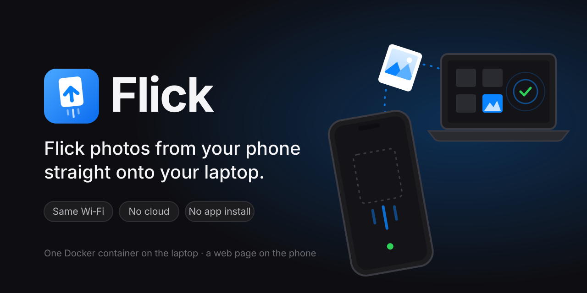

# Flick



Pick a photo on your phone, point the phone at your laptop, swipe the photo up (or flick the
phone towards the laptop), and it is saved into a folder on the laptop. Same Wi-Fi, direct
connection, no cloud, no app to install.

## How it works

- The laptop runs one Docker container. It serves a web page to the phone and writes
  received photos into a folder you choose (for example your Desktop).
- The phone opens that page over HTTPS with a self-signed certificate (phone browsers only
  give compass access to secure pages) and pairs once by scanning a QR code on the laptop.
- A photo is sent when you swipe it up, or flick the phone, while the phone points at the
  laptop. Without a compass the page falls back to swipe-only and says so.

## Setup (about 5 minutes)

You need Docker (Docker Desktop on macOS and Windows, Docker Engine + the compose plugin on
Linux) and the laptop and phone on the same Wi-Fi.

### 1. Get the code

```sh
git clone https://github.com/rimmelasghar/Flicker.git flick
cd flick
```

### 2. Write your settings into `.env`

Detect the laptop's Wi-Fi address (this creates `.env` from `.env.example`):

| macOS / Linux | Windows (PowerShell) |
|---|---|
| `scripts/detect-ip.sh` | `powershell -ExecutionPolicy Bypass -File scripts\detect-ip.ps1` |

Then open `.env` and set `INBOX_DIR`, the folder where photos should land:

| OS | Example `INBOX_DIR` |
|---|---|
| macOS | `/Users/<you>/Desktop` |
| Windows | `C:/Users/<you>/Desktop` (or `C:/Users/<you>/OneDrive/Desktop` if OneDrive manages your Desktop) |
| Linux | `/home/<you>/Desktop` |

On Linux also set `PUID` and `PGID` to the output of `id -u` and `id -g`.

### 3. Let the phone reach the laptop (once per computer)

**Windows.** Windows blocks incoming connections to Docker on networks marked *Public*.
1. Settings → Network & internet → Wi-Fi → your network → Network profile type: **Private**.
2. In PowerShell **run as administrator**, allow the phone port on private networks only:
   ```powershell
   New-NetFirewallRule -DisplayName "Flick phone (8443)" -Direction Inbound -Protocol TCP -LocalPort 8443 -Action Allow -Profile Private
   ```

**macOS.** If the application firewall is on and asks whether Docker may accept incoming
connections, choose **Allow**. Docker Desktop shares `/Users` by default, so the Desktop works
without changes.

**Linux.** If a firewall is active, open the phone port, e.g. `sudo ufw allow 8443/tcp`.

### 4. Start Flick

```sh
docker compose up -d
```

The first start builds the image (about a minute) and creates the certificate and pairing
token in a Docker volume.

### 5. Pair the phone

1. On the laptop open **http://localhost:8080/pair**. This page only works on the laptop.
2. Scan the QR code with the phone camera and open the link.
3. Accept the certificate warning once:
   - iPhone Safari: *Show Details* → *visit this website* → *Visit Website*.
   - Android Chrome: *Advanced* → *Proceed*.
4. The badge at the top says **Paired**. The phone stays paired across restarts.

### 6. Calibrate and send

1. iPhone: tap **Enable compass** and allow *Motion & Orientation*. Android starts the
   compass by itself.
2. Tap **Calibrate**, point the top of the phone at the laptop, tap **This is my laptop**.
3. Tap **Choose photos** and pick one or more. While the phone points at the laptop the dot
   and the photo outline turn green.
4. Swipe the photo up, or hold still for a moment and flick the phone towards the laptop.
   The photo appears in `INBOX_DIR` as `YYYYMMDD-HHMMSS-<name>.<ext>`.

Optional: *Share → Add to Home Screen* (iPhone) or *Install app* (Android) for a full-screen
icon. On iPhone the home-screen app may keep its own storage and show *Not paired*; this is
not yet verified.

## Troubleshooting

| Problem | Fix |
|---|---|
| Phone says *Laptop unreachable*, or the page does not load | Same Wi-Fi (not a guest network)? Windows: step 3. Check the laptop IP has not changed (below). |
| Laptop IP changed (router restart) | Run the detect-ip script again, then `docker compose up -d`, open the pair page and scan again. The phone shows the certificate warning once more. A DHCP reservation on the router avoids this. |
| *Not paired* | Open http://localhost:8080/pair and scan the QR code again. |
| A phone should no longer be able to send | On the pair page click **Unpair all phones (new code)**, then re-pair the phones you keep. |
| Flicks are rejected although you point at the laptop | Tap **Re-calibrate**. Hold the phone the way you hold it when sending; the laptop's own magnets disturb the compass up close. |
| Shaking or putting the phone down | Does not send: a phone flick needs a still moment, one sharp snap, and no swing back. Turn it off with *Flick the phone to send: off*. |
| No compass (some browsers, laptops) | The page says *swipe-only* and sends on swipe without the direction check. |

## Configuration

All settings live in `.env` (see `.env.example`).

| Variable | Required | Default | Meaning |
|---|---|---|---|
| `HOST_IP` | yes | — | Laptop LAN IP; used in the QR code and the certificate |
| `INBOX_DIR` | yes | — | Folder on the laptop where photos are saved |
| `MAX_FILE_MB` | no | 50 | Per-file size limit |
| `PUID` / `PGID` | Linux | 1000 | Owner of saved files: the container runs as this user (`id -u` / `id -g`) |
| `ANGLE_TOLERANCE` | no | 35 | ± degrees for the direction check (the phone page currently always uses 35) |

Ports: `8443` (phone page and API, reachable on the LAN) and `8080` (pairing page, bound to
`127.0.0.1` only). Nothing leaves your network.

## Development

```sh
pip install -r requirements.txt -r requirements-dev.txt
ruff check . && ruff format --check . && pytest
```

Contribution rules (branches, commits, milestones): see `AGENTS.md`.
